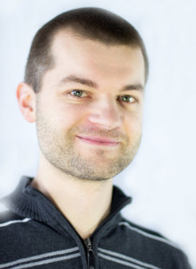
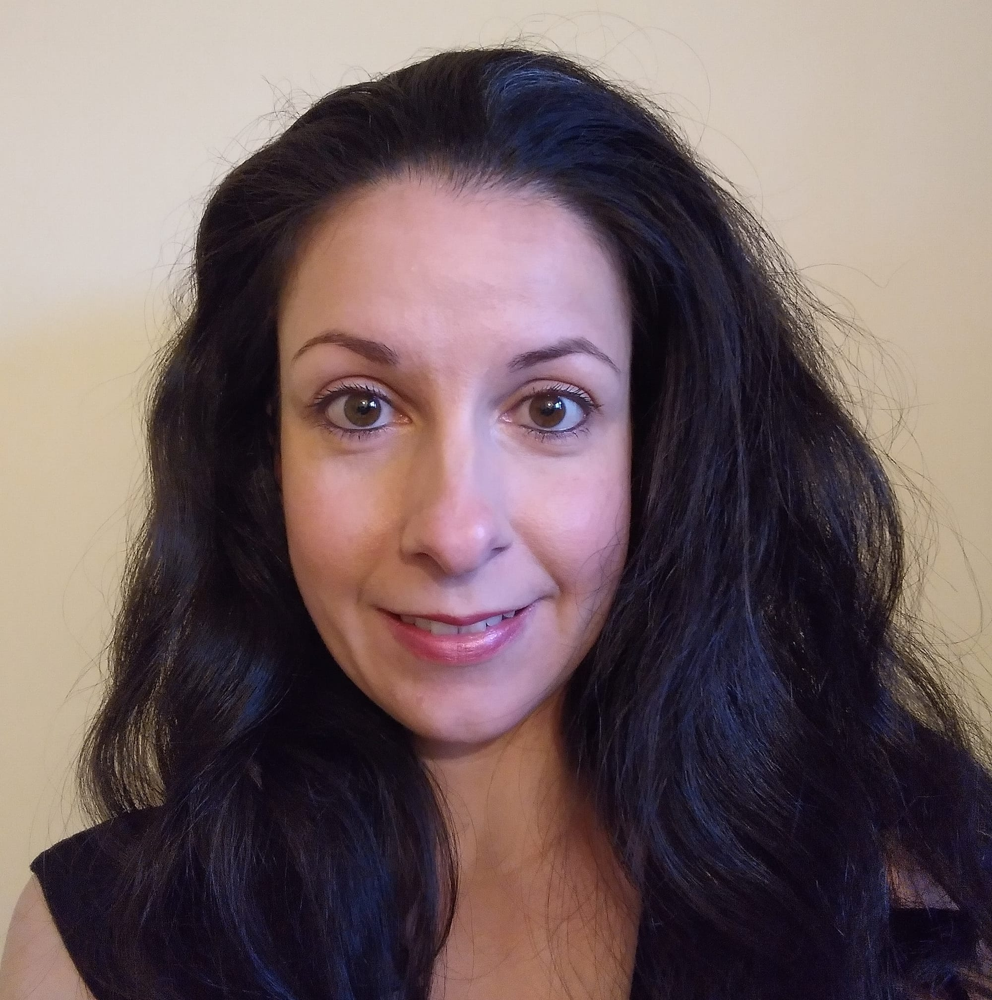
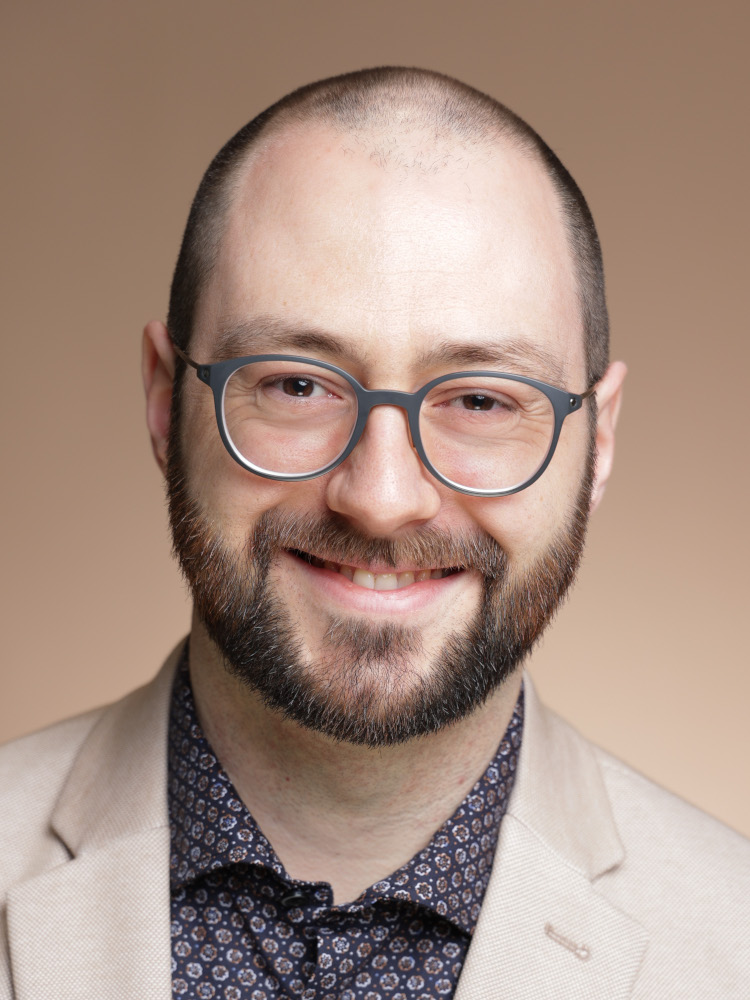

# STACK Sharing Network

The STACK Sharing Network brings together creators and managers of STACK question collections who are willing to share their materials and collaborate on effective sharing practices.
The STACK Sharing Network aims to facilitate the discovery, sharing, and reuse of high-quality STACK questions across different contexts.

In particular:

* Develop effective strategies and standards for organizing and categorizing large collections of STACK questions to ensure they are easily discoverable by users.
* Facilitate discussion and consensus on essential metadata standards required for robust question description and retrieval.
* Define streamlined processes and requirements for contributing questions, ensuring consistency, quality, and ease of integration into shared repositories.
* Explore and specify desired functionalities for potential database or platform solutions that support efficient searching, filtering, management, and contribution of STACK questions at scale.
* Foster a collaborative community dedicated to sharing expertise and resources related to the creation, management, curation, and deployment of STACK questions.
* Reduce redundant effort by enabling users to build upon existing work rather than starting from scratch.

If you would like to join the Network, please

* join the [STACK Sharing Network channel on the STACK project's Zulip chat](https://stack-assessment.zulipchat.com/#narrow/channel/496986-STACK-Sharing-Network), and
* contact Michael Kallweit (<a href="mailto:michael.kallweit@rub.de">michael.kallweit@rub.de</a>) to add your details to this page.

## Members

	

    

		<h4>Dr Michael Kallweit</h4>
		
Ruhr University Bochum, Germany 
		  <a href="mailto:michael.kallweit@rub.de">michael.kallweit@rub.de</a> 
		  <em>Network Organiser</em>
		

		
Projects:
			DOMAIN,
            STACK.nrw
		

	

	

    

		<h4>Konstantina Zerva</h4>
		
The University of Edinburgh, UK 
		  <a href="mailto:k.zerva@ed.ac.uk">k.zerva@ed.ac.uk</a>
		

		
Projects:
			HELM
		

	

	

    

		<h4>Benjamin Schulz-Rosenberger</h4>
		
Ruhr University Bochum, Germany 
		  <a href="mailto:benjamin.schulz-c95@rub.de">benjamin.schulz-c95@rub.de</a>
		

		
Projects:
			STACK.nrw
		

	

## Open collections/databases for STACK questions
* STACK Question Library (available within the STACK plugin)
* [HELM - Helping Engineers Learn Mathematics Workbooks](https://docs.stack-assessment.org/en/STACK_question_admin/Library/HELM/) (part of the STACK Question Library, [source files on GitHub](https://github.com/maths/moodle-qtype_stack/tree/master/samplequestions/stacklibrary/HELM))
* [DOMAIN - Database of Math Instructions](https://db.ak-mathe-digital.de/) (mostly german questions)
